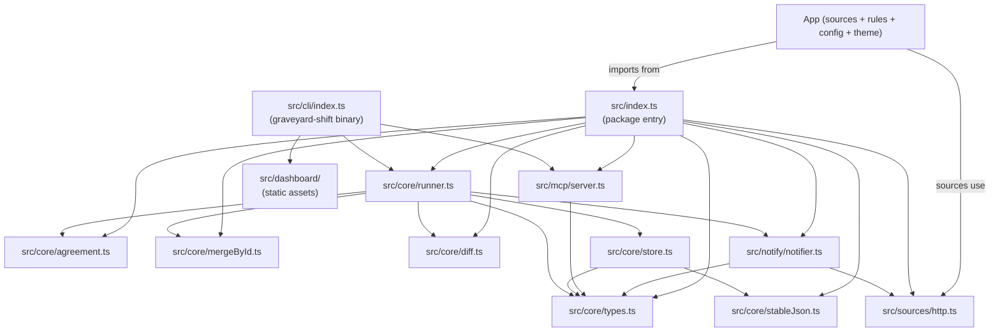

# Design Document

## Overview

The `skeleton/` workspace package (`graveyard-shift`) is a reusable Node.js 22 library that provides every shared concern for watch-and-warn apps: types, runner pipeline, HTTP helper, diff engine, stable-JSON store, static dashboard, MCP stdio server, GitHub notifier, and a CLI entry point. App authors supply four files — sources, rules, config, and theme — and import everything else from `graveyard-shift`.

The central invariant is that a finding is only **confirmed** when at least two independent sources agree. A single-source finding is a **ghost**: visible but never triggering an alert.

All pure logic (types, agreement rule, diff, mergeById, stable-JSON serialiser) is isolated from I/O. Network calls live in `src/sources/`, file I/O lives in `src/core/store.ts` and `src/notify/`, and the dashboard has no server-side component.

### Key Design Decisions

- **No bundler**: `tsc` compiles to `dist/` with `"type": "module"` in `package.json`. All imports use `.js` extensions at source time (TypeScript resolves them to `.ts`).
- **No extra runtime deps**: `fetch` and `AbortSignal.timeout` are built into Node.js 22. The only runtime dependencies are `@modelcontextprotocol/sdk` and `zod`.
- **Pure-core boundary**: the agreement rule, diff, mergeById, and stableJSON are pure functions with no side effects. This makes them trivially testable and composable.
- **Stale carry-forward**: when a source errors, its previous contributions are preserved in the current run to avoid falsely resolving findings. Staleness is surfaced through `staleError` on `Evidence` entries and a derived `stale` boolean on `Finding`.

---

## Architecture

### Component Diagram



### Module Responsibilities

| Module | Pure? | Exports |
|---|---|---|
| `src/core/types.ts` | yes | `Finding`, `SourceResult`, `AppDefinition`, `Evidence`, `Fix`, `Edit`, `DiffResult`, `RunRecord` |
| `src/core/agreement.ts` | yes | `applyAgreementRule(findings)` |
| `src/core/mergeById.ts` | yes | `mergeById(results)` |
| `src/core/diff.ts` | yes | `computeDiff(prev, curr)` |
| `src/core/stableJson.ts` | yes | `stableStringify(value)` |
| `src/core/runner.ts` | no | `runApp(appDef, configPath, dataDir)` |
| `src/core/store.ts` | no | `readStore(dir)`, `writeStore(dir, findings, diff, runRecord)` |
| `src/sources/http.ts` | no | `createHttpClient(opts)` → `httpGet(url, opts)` |
| `src/mcp/server.ts` | no | `createMcpServer(dataSource)` |
| `src/notify/notifier.ts` | no | `notify(diff, findings, opts)` |
| `src/cli/index.ts` | no | CLI entry point (no exports) |
| `src/index.ts` | — | Re-exports all public API |

---

## Components and Interfaces

### Package Entry Point (`src/index.ts`)

The single import point for app authors. Re-exports every public type and function:

```typescript
export type { Finding, SourceResult, AppDefinition, Evidence, Fix, Edit, DiffResult } from './core/types.js';
export { mergeById } from './core/mergeById.js';
export { createHttpClient } from './sources/http.js';
export { createMcpServer } from './mcp/server.js';
export { notify } from './notify/notifier.js';
export { runApp } from './core/runner.js';
```

App authors never import from internal paths — only from `graveyard-shift`.

### `package.json` Structure

```json
{
  "name": "graveyard-shift",
  "version": "0.1.0",
  "type": "module",
  "exports": {
    ".": "./dist/index.js"
  },
  "bin": {
    "graveyard-shift": "./dist/cli/index.js"
  },
  "files": ["dist", "src/dashboard"],
  "dependencies": {
    "@modelcontextprotocol/sdk": "<pinned>",
    "zod": "<pinned>"
  },
  "devDependencies": {
    "typescript": "<pinned>",
    "vitest": "<pinned>",
    "fast-check": "<pinned>",
    "@vitest/coverage-v8": "<pinned>"
  }
}
```

The workspace root `package.json` declares `"workspaces": ["skeleton", "apps/*"]`.

### HTTP Helper (`src/sources/http.ts`)

```typescript
interface HttpClientOptions {
  userAgent: string;           // e.g. "graveyard-shift/0.1.0 (+https://github.com/owner/repo)"
  timeoutMs?: number;          // default 30_000
  maxAttempts?: number;        // default 3
  concurrencyPerHost?: number; // default 4
}

interface HttpRequestOptions {
  timeoutMs?: number;    // per-call override
  maxAttempts?: number;  // per-call override
  headers?: Record<string, string>;
}

interface HttpClient {
  get(url: string, opts?: HttpRequestOptions): Promise<Response>;
}

function createHttpClient(opts: HttpClientOptions): HttpClient;
```

**Concurrency queue**: a `Map<string, Semaphore>` keyed by hostname. Each `Semaphore` is a simple counter + promise queue that limits simultaneous in-flight requests to `concurrencyPerHost`. A slot is acquired before the fetch begins and released in a `finally` block.

```
Semaphore:
  count: number (starts at concurrencyPerHost)
  queue: Array<() => void>

  acquire(): Promise<void>
    if count > 0: count--, resolve immediately
    else: push resolver onto queue, return promise

  release(): void
    if queue.length > 0: dequeue one resolver, call it
    else: count++
```

**Retry loop**:

```
attempt = 1
loop:
  signal = AbortSignal.timeout(effectiveTimeoutMs)
  try:
    response = await fetch(url, { signal, headers })
    if response.ok: return response
    if 4xx and not 429: throw HttpError(status, url)  // no retry
    if 429 or 503:
      delay = parseRetryAfter(response) ?? exponentialBackoff(attempt)
      if attempt >= maxAttempts: throw HttpError(status, url)
      await sleep(delay)
      attempt++; continue
    if 5xx:
      if attempt >= maxAttempts: throw HttpError(status, url)
      await sleep(exponentialBackoff(attempt))
      attempt++; continue
  catch AbortError (timeout):
    if attempt >= maxAttempts: throw HttpError("timeout", url)
    await sleep(exponentialBackoff(attempt))
    attempt++; continue
  catch NetworkError:
    if attempt >= maxAttempts: throw HttpError(message, url)
    await sleep(exponentialBackoff(attempt))
    attempt++; continue
```

**Backoff formula**: `min(base * 2^(attempt-1) + jitter, maxDelay)` where `base = 500ms`, `maxDelay = 30_000ms`, `jitter = Math.random() * 500`.

**Retry-After parsing**: accepts both `Retry-After: <seconds>` (integer) and `Retry-After: <HTTP-date>` (RFC 7231 date string). Returns the computed delay in milliseconds, capped to `maxDelay`.

**User-Agent**: set at client creation time. The version is read from the package's own `package.json` at module load time using `import.meta.url` and `fs.readFileSync` (synchronous, called once).

### Agreement Rule (`src/core/agreement.ts`)

```typescript
interface PartialFinding {
  id: string;
  title: string;
  sources: string[];
  evidence: Evidence[];
  [key: string]: unknown;
}

function applyAgreementRule(findings: PartialFinding[]): PartialFinding[];
```

For each finding, count the number of distinct values in `sources` (case-sensitive). If the count is ≥ 2, set `status: "confirmed"`; otherwise set `status: "ghost"`. All other fields are passed through unchanged. The function never mutates its inputs — it returns new objects via spread.

```typescript
function distinctCount(sources: string[]): number {
  return new Set(sources).size;
}
```

### mergeById (`src/core/mergeById.ts`)

```typescript
function mergeById(results: SourceResult[]): PartialFinding[];
```

Algorithm:
1. Create a `Map<string, { title, sources: Set<string>, evidence: Evidence[] }>`.
2. Iterate `results` in order. For each item in `result.findings`:
   - If id not in map, insert `{ title: item.title, sources: new Set([result.sourceName]), evidence: [...] }`.
   - If id already in map and `result.sourceName` not yet in `sources`: add sourceName, push one Evidence entry with `sourceName`, `text: item.title`, and `details` converted to a text string if present.
   - If id already in map and `result.sourceName` already in `sources`: skip (de-duplicate same source reporting same id).
3. Convert map to array: `{ id, title, sources: [...sourcesSet], evidence }`.

No mutation of input arrays or objects. The function copies finding fields into new objects.

Evidence text for a merged item: `item.details` is a `Record<string, unknown>` on the raw source item. The rules function is responsible for converting it into a human-readable `text` string for the evidence entry; `mergeById` uses the item's `title` as the default evidence text when `details` is absent.

### Diff Engine (`src/core/diff.ts`)

```typescript
interface DiffResult {
  appeared: string[];
  still: string[];
  resolved: string[];
  promoted: string[];
  demoted: string[];
}

function computeDiff(prev: Finding[], curr: Finding[]): DiffResult;
```

Algorithm:

```
prevMap = Map from id → status (from prev array)
currMap = Map from id → status (from curr array)

appeared = ids in currMap but not prevMap
still    = ids in both maps
resolved = ids in prevMap but not currMap

promoted = ids in still where prevMap[id] === "ghost" && currMap[id] === "confirmed"
demoted  = ids in still where prevMap[id] === "confirmed" && currMap[id] === "ghost"
```

No sorting is applied to the output arrays; order matches insertion order. The function returns new arrays; inputs are not mutated.

### Stable JSON (`src/core/stableJson.ts`)

```typescript
function stableStringify(value: unknown): string;
```

Algorithm (recursive):
- `null`, `boolean`, `number`, `string`: delegate to `JSON.stringify` for the scalar.
- `Array`: map each element through `stableStringify`, join with `,\n`-equivalent; use `JSON.stringify`'s array formatting but override object serialisation.
- `Object`: sort keys by Unicode code point order (`Object.keys(obj).sort()`), then for each key produce `"<key>": <stableStringify(value)>`.
- The result is formatted with 2-space indentation and a trailing `\n` at the top level.

Implementation uses a custom recursive serialiser rather than `JSON.stringify`'s replacer, which does not guarantee key order across all runtimes:

```typescript
function stableStringify(value: unknown, indent = 0): string {
  if (value === null || typeof value !== 'object') {
    return JSON.stringify(value);
  }
  if (Array.isArray(value)) {
    const items = value.map(v => '  '.repeat(indent + 1) + stableStringify(v, indent + 1));
    return items.length === 0
      ? '[]'
      : '[\n' + items.join(',\n') + '\n' + '  '.repeat(indent) + ']';
  }
  const keys = Object.keys(value as object).sort();
  const entries = keys.map(k => {
    const v = stableStringify((value as Record<string, unknown>)[k], indent + 1);
    return '  '.repeat(indent + 1) + JSON.stringify(k) + ': ' + v;
  });
  return entries.length === 0
    ? '{}'
    : '{\n' + entries.join(',\n') + '\n' + '  '.repeat(indent) + '}';
}

export function stableStringify(value: unknown): string {
  return stableStringifyInner(value, 0) + '\n';
}
```

### Store (`src/core/store.ts`)

```typescript
interface StoreData {
  findings: Finding[];
  history: HistoryRecord[];
  runs: RunRecord[];
}

interface HistoryRecord {
  runAt: string;
  appeared: string[];
  still: string[];
  resolved: string[];
  promoted: string[];
  demoted: string[];
}

interface RunRecord {
  runAt: string;
  confirmedCount: number;
  ghostCount: number;
  resolvedCount: number;
  errorSources: string[];
}

function readStore(dataDir: string): Promise<StoreData>;
function writeStore(
  dataDir: string,
  findings: Finding[],
  diff: DiffResult,
  runRecord: RunRecord,
  retentionDays: number
): Promise<void>;
```

**`readStore`**: reads `findings.json`, `history.json`, `runs.json` from `dataDir`. If a file is absent, returns an empty default (empty array for findings/history/runs). Uses `fs/promises` with try/catch on `ENOENT`.

**`writeStore`**:
1. Apply resolved retention: filter out findings where `resolvedAt` is set and is older than `retentionDays` days from now.
2. Sort remaining findings by `id` in ascending lexicographic order.
3. Derive `stale` field: for each finding, if any evidence entry has `staleError`, set `stale: true`; otherwise omit the field.
4. Read existing `history.json` and `runs.json` (initialise to `[]` if absent or unparseable).
5. Append new `HistoryRecord` to history array.
6. Append new `RunRecord` to runs array.
7. Write all three files atomically: write to a temp file in the same directory, then `rename` to the final path. This prevents partial writes corrupting the store.
8. Serialise each file with `stableStringify`.

Atomicity: Node.js `fs.rename` is atomic within the same filesystem (a single directory), preventing partial-write corruption.

### Runner (`src/core/runner.ts`)

The runner orchestrates the full app cycle. See the data flow diagram in the next section.

```typescript
interface RunnerOptions {
  appDir: string;
  dataDir: string;
  configPath: string;
  dryRun?: boolean;
}

async function runApp(appDef: AppDefinition<z.ZodTypeAny>, opts: RunnerOptions): Promise<void>;
```

### MCP Server (`src/mcp/server.ts`)

```typescript
type DataSource =
  | { type: 'local'; dir: string }
  | { type: 'remote'; baseUrl: string };

interface McpServerHandle {
  close(): Promise<void>;
}

function createMcpServer(source: DataSource): McpServerHandle;
```

The factory uses `McpServer` from `@modelcontextprotocol/sdk/server/mcp` and `serveStdio` from `@modelcontextprotocol/sdk/server/stdio`. It registers four tools using zod schemas for input validation.

**Data source abstraction**:

```typescript
interface DataLoader {
  loadFindings(): Promise<Finding[]>;
  loadRuns(): Promise<RunRecord[]>;
}

function makeDataLoader(source: DataSource): DataLoader {
  if (source.type === 'local') {
    return {
      loadFindings: () => readJsonFile(path.join(source.dir, 'findings.json')),
      loadRuns: () => readJsonFile(path.join(source.dir, 'runs.json')),
    };
  }
  return {
    loadFindings: () => fetchJson(`${source.baseUrl}/findings.json`),
    loadRuns: () => fetchJson(`${source.baseUrl}/runs.json`),
  };
}
```

Each tool call invokes the data loader fresh (no caching), so findings are always current.

**Tool schemas** (zod):

```typescript
const listFindingsInput = z.object({
  status: z.enum(['confirmed', 'ghost', 'all']).default('all'),
});

const getFindingInput = z.object({
  id: z.string(),
});

const summaryInput = z.object({});

const explainFindingInput = z.object({
  id: z.string(),
});
```

**Error objects** returned (not thrown) by tools:

```typescript
type McpError =
  | { code: 'NOT_FOUND'; message: string }
  | { code: 'VALIDATION_ERROR'; message: string }
  | { code: 'UNAVAILABLE'; message: string };
```

### Notifier (`src/notify/notifier.ts`)

```typescript
interface NotifierOptions {
  repo?: string;       // defaults to GITHUB_REPOSITORY env var
  dryRun?: boolean;
  maxNewIssues?: number;    // default 5
  maxNewPRs?: number;       // default 5
}

async function notify(
  diff: DiffResult,
  findings: Finding[],
  opts?: NotifierOptions
): Promise<void>;
```

The notifier uses the `fetch`-based HTTP helper (wrapping the GitHub REST API). All GitHub API calls go through a shared client instance configured with the `GITHUB_TOKEN` Bearer header and the project User-Agent.

**Issue deduplication**: searches for open issues with `repo:owner/repo is:issue is:open in:title "<findingId>"` using the GitHub search API. If an issue is found, its number is used for update; otherwise a new issue is opened.

**PR deduplication**: same search pattern using `is:pr`.

**Trigger logic**:
- Open/update issue: finding id is in `diff.appeared` with status `confirmed`, OR in `diff.promoted`.
- Close issue: finding id is in `diff.resolved` AND an open issue exists for it.
- Open PR: finding id is in `diff.appeared` with status `confirmed` AND the finding has `edits`, AND no open PR exists.

**Branch naming**: `graveyard-shift/<findingId>` (sanitised to replace non-alphanumeric chars with `-`).

**Label**: creates the `graveyard-shift` label in the repo if it does not exist, then adds it to every created issue or PR.

**Retry**: uses `createHttpClient` with `maxAttempts: 3` and exponential backoff. The Retry-After header from GitHub's secondary rate limiter is handled automatically by the HTTP helper.

### CLI (`src/cli/index.ts`)

No third-party argument parsing. Uses `process.argv.slice(2)` with a hand-written dispatcher:

```typescript
const [command, ...args] = process.argv.slice(2);

switch (command) {
  case 'run':  return cmdRun(args);
  case 'site': return cmdSite(args);
  case 'mcp':  return cmdMcp(args);
  default:     printUsage(); process.exit(1);
}
```

**`graveyard-shift run <appDir>`**:
1. Dynamic import of `<appDir>/index.js` to load `AppDefinition`.
2. Locate config file at `<appDir>/config.json` (or path from `--config` flag).
3. Locate data dir at `<appDir>/data/` (or path from `--data` flag).
4. Call `runApp(appDef, opts)`.
5. Exit 0 on success, exit 1 on any error (message to stderr).

**`graveyard-shift site <appDir> <outDir>`**:
1. Dynamic import of `<appDir>/index.js` to read `theme` metadata.
2. Copy all files from `src/dashboard/` to `<outDir>`.
3. Write `<outDir>/theme.json` as `stableStringify({ name, tagline, accentColor, labels })`.
4. Exit 0 on success, exit 1 on error.

**`graveyard-shift mcp <dataDirOrUrl>`**:
1. Determine data source type: if starts with `https://`, use `{ type: 'remote', baseUrl }`, else `{ type: 'local', dir }`.
2. Call `createMcpServer(source)`.
3. Register `SIGINT`/`SIGTERM` handlers calling `handle.close()`.
4. Keep process alive until stdin closes (stdio server handles this via `serveStdio`).

### Dashboard (`src/dashboard/`)

Three files:
- `index.html`: structural skeleton, links to `style.css` and `app.js` with `type="module"`.
- `style.css`: layout, severity colour coding, WCAG AA contrast ratios, filter control styling, dark/light mode via CSS custom properties.
- `app.js`: vanilla ES module, no framework.

**Base URL resolution**: all fetch calls use paths relative to the HTML page's location:

```javascript
const base = new URL('.', document.baseURI).href;
async function loadJson(name) {
  const res = await fetch(base + name);
  if (!res.ok) throw Object.assign(new Error(res.statusText), { status: res.status });
  return res.json();
}
```

This ensures correct operation from any GitHub Pages subpath (e.g. `https://owner.github.io/repo/poltergeist/`).

**Load sequence**:
1. `findings.json` → parse findings, compute aggregate counts.
2. `runs.json` → extract last run timestamp and error sources.
3. `theme.json` (optional, catch on failure) → apply theme tokens or fall back to defaults.

**Theme application**: CSS custom properties are set on `:root` (`--accent-color`, `--label-confirmed`, etc.) from `theme.json` values. If `theme.json` is absent, the CSS file provides default values.

**Filter control**: a `<fieldset>` with four radio buttons (`all`, `confirmed`, `ghost`, `resolved`). Changing selection calls `renderFindings(filter)` which re-renders from the in-memory array without re-fetching.

**Counts**: computed from the full unfiltered findings array before any filter is applied. Updated whenever findings data changes.

**WCAG AA**: all text uses CSS custom properties with fallback values chosen to meet ≥ 4.5:1 contrast on both light and dark backgrounds. Status distinction between `confirmed`, `ghost`, and `resolved` uses a text badge AND a left border pattern (not colour alone).

---

## Data Models

### Finding

```typescript
interface Finding {
  id: string;                          // stable, app-assigned
  title: string;
  summary: string;
  severity: 'critical' | 'high' | 'medium' | 'low' | 'info';
  status: 'confirmed' | 'ghost';
  sources: string[];                   // min length 1
  evidence: Evidence[];
  firstSeen: string;                   // ISO 8601, managed by Runner
  lastSeen: string;                    // ISO 8601, managed by Runner
  resolvedAt?: string;                 // ISO 8601, present only when resolved
  url?: string;
  fix?: Fix;
  edits?: Edit[];
  stale?: true;                        // derived by Store; present only when true
}
```

### Evidence

```typescript
interface Evidence {
  sourceName: string;
  text: string;
  link?: string;
  staleError?: string;   // present only when this source errored this run
}
```

### Fix

```typescript
interface Fix {
  text: string;
  value?: string;   // e.g. first-fixed version, replacement URL
}
```

### Edit

```typescript
interface Edit {
  path: string;
  newContent: string;
}
```

### SourceResult

```typescript
interface SourceResult {
  sourceName: string;
  findings: Array<{
    id: string;
    title: string;
    details?: Record<string, unknown>;
  }>;
  fetchedAt: string;   // ISO 8601
}
```

### AppDefinition

```typescript
interface AppDefinition<TSchema extends z.ZodTypeAny> {
  sources: Array<(config: z.infer<TSchema>) => Promise<SourceResult>>;  // min length 1
  rules: (
    results: SourceResult[],
    config: z.infer<TSchema>
  ) => Array<Omit<Finding, 'firstSeen' | 'lastSeen' | 'resolvedAt' | 'stale'>>;
  configSchema: TSchema;
  theme: {
    name: string;
    tagline: string;
    accentColor: string;     // CSS colour string
    labels?: {
      confirmed?: string;
      ghost?: string;
      resolved?: string;
    };
  };
}
```

### DiffResult

```typescript
interface DiffResult {
  appeared: string[];
  still: string[];
  resolved: string[];
  promoted: string[];
  demoted: string[];
}
```

### RunRecord

```typescript
interface RunRecord {
  runAt: string;
  confirmedCount: number;
  ghostCount: number;
  resolvedCount: number;
  errorSources: string[];
}
```

---

## Data Flows

### Runner Pipeline

```
graveyard-shift run <appDir>
        │
        ▼
┌───────────────────┐
│  Load AppDef      │  dynamic import(<appDir>/index.js)
│  Parse config     │  zod.parse(configSchema, configJson)
└────────┬──────────┘
         │ on validation failure → stderr + exit(1)
         ▼
┌───────────────────┐
│  Fetch sources    │  Promise.allSettled([src1(cfg), src2(cfg), ...])
│  (concurrent)     │
└────────┬──────────┘
         │
         ├── fulfilled: SourceResult[]  ──────────┐
         │                                         │
         └── rejected: { name, error }[] ──────┐  │
                                                 │  │
         ▼                                       │  │
┌───────────────────┐                            │  │
│  Stale carry-fwd  │◄───── erroredSources ──────┘  │
│  from prev store  │                               │
└────────┬──────────┘                               │
         │                                          │
         │  staleSources: Array<{                   │
         │    sourceName, staleError,               │
         │    contributions: Map<id, Evidence>       │
         │  }>                                      │
         │                                          │
         ▼                                          │
┌───────────────────┐                              │
│  Merge results    │◄─── freshResults ────────────┘
│  rules(results,   │
│    cfg) →         │
│  partialFindings  │
│  mergeById(...)   │
└────────┬──────────┘
         ▼
┌───────────────────┐
│  Agreement rule   │  confirmed iff sources.distinct >= 2
└────────┬──────────┘
         ▼
┌───────────────────┐
│  Timestamp mgmt   │  firstSeen: prev or now
│                   │  lastSeen: now
│                   │  resolvedAt: set on resolved ids
└────────┬──────────┘
         ▼
┌───────────────────┐
│  computeDiff      │  appeared/still/resolved/promoted/demoted
└────────┬──────────┘
         ▼
┌───────────────────┐
│  writeStore       │  findings.json (with retention filter + stale derivation)
│                   │  history.json (append)
│                   │  runs.json (append)
└────────┬──────────┘
         ▼
┌───────────────────┐
│  notify           │  issue/PR open/update/close (if not dryRun)
└───────────────────┘
```

### Stale Carry-Forward Model

When a source errors during a run, its previous contributions must be preserved to avoid falsely resolving findings that the source would have reported if it had succeeded.

```
Previous findings.json:
  finding "vuln-A": sources: ["osv", "ghsa"], evidence: [
    { sourceName: "osv", text: "CVE-2024-1234 affects lodash@4.17.20" },
    { sourceName: "ghsa", text: "GHSA-xxxx-yyyy affects lodash@4.17.20" }
  ]

Current run: ghsa source throws an error.

Stale carry-forward:
  1. Identify errored sources: ["ghsa"]
  2. For each errored source, find all (id, evidence) pairs in prev findings.json
     where that source appears.
  3. Inject a stale SourceResult:
     {
       sourceName: "ghsa",
       findings: [{ id: "vuln-A", title: "GHSA-xxxx-yyyy..." }],
       fetchedAt: <now>,
     }
     And mark the evidence entry with staleError: "connect ECONNREFUSED ..."
  4. Pass [freshOsvResult, staleGhsaResult] to rules + mergeById.

Result in findings.json:
  finding "vuln-A": sources: ["osv", "ghsa"], status: "confirmed",
  evidence: [
    { sourceName: "osv", text: "..." },
    { sourceName: "ghsa", text: "...", staleError: "connect ECONNREFUSED ..." }
  ],
  stale: true

runs.json:
  { ..., errorSources: ["ghsa"] }
```

The `stale: true` boolean is derived by the store when writing `findings.json`: the store checks each finding's evidence array for any entry with `staleError` and sets the field accordingly. The runner never sets `stale` directly.

### Notifier Trigger Logic

```
diff computed by Runner:

appeared = ["vuln-A", "vuln-B"]    ← new findings this run
  "vuln-A" status = confirmed      → open issue for vuln-A
  "vuln-B" status = ghost          → no action

promoted = ["vuln-C"]              ← was ghost, now confirmed
  → open/update issue for vuln-C

resolved = ["vuln-D"]              ← no longer present
  → close issue for vuln-D (if open)

still = [...]                      → no issue action

For each finding in appeared(confirmed) ∪ promoted:
  if finding has .edits and no open PR: open PR

Cap: track openedIssues and openedPRs counters per run.
When counter reaches cap: log warning, skip remaining.
```

---

## Correctness Properties

*A property is a characteristic or behavior that should hold true across all valid executions of a system — essentially, a formal statement about what the system should do. Properties serve as the bridge between human-readable specifications and machine-verifiable correctness guarantees.*

### Property 1: Confirmed invariant

*For any* array of `SourceResult` values, every finding whose id appears in two or more `SourceResult` objects with distinct `sourceName` values SHALL be assigned status `confirmed` by the agreement rule.

**Validates: Requirements 3.1, 3.3, 3.4**

### Property 2: Ghost invariant

*For any* array of `SourceResult` values, every finding whose id appears in exactly one `SourceResult` object (regardless of how many times that source lists the id) SHALL be assigned status `ghost` by the agreement rule.

**Validates: Requirements 3.2, 3.4, 3.6, 3.7**

### Property 3: Agreement rule idempotence

*For any* array of `SourceResult` values, applying the agreement rule twice SHALL produce the same set of finding statuses as applying it once.

**Validates: Requirements 3.5**

### Property 4: Agreement rule preserves non-status fields

*For any* partial finding with arbitrary `id`, `title`, `summary`, `severity`, `evidence`, `url`, `fix`, and `edits` fields, applying the agreement rule SHALL not modify any field other than `status`.

**Validates: Requirements 3.8**

### Property 5: mergeById produces no duplicate source names

*For any* array of `SourceResult` values, no output finding returned by `mergeById` SHALL have a `sources` array containing duplicate source-name strings.

**Validates: Requirements 4.3**

### Property 6: mergeById evidence count matches source item count (one-per-source)

*For any* array of `SourceResult` values where no source reports the same finding id more than once, the total number of `Evidence` entries across all `mergeById` output findings SHALL equal the total number of source items across all input `SourceResult` values.

**Validates: Requirements 4.1, 4.2, 4.4**

### Property 7: mergeById does not mutate inputs

*For any* array of `SourceResult` values, after calling `mergeById`, the input arrays and all `SourceResult` objects within them SHALL be deeply equal to their state before the call.

**Validates: Requirements 4.7**

### Property 8: Diff completeness

*For any* two findings arrays `prev` and `curr` with unique ids within each array, the union of `appeared`, `still`, and `resolved` in `computeDiff(prev, curr)` SHALL equal the union of all ids from `prev` and all ids from `curr`.

**Validates: Requirements 6.1, 6.3**

### Property 9: Diff stability

*For any* findings array `A`, `computeDiff(A, A)` SHALL return empty arrays for `appeared`, `resolved`, `promoted`, and `demoted`.

**Validates: Requirements 6.4**

### Property 10: Diff promoted and demoted are subsets of still

*For any* two findings arrays, in the result of `computeDiff`, every id in `promoted` SHALL also be in `still`, every id in `demoted` SHALL also be in `still`, and no id SHALL appear in both `promoted` and `demoted`.

**Validates: Requirements 6.6, 6.7, 6.8**

### Property 11: Diff monotonicity

*For any* three findings arrays `A`, `B`, and `C`, the `resolved` set of `computeDiff(A, C)` SHALL be a subset of the union of `resolved` sets of `computeDiff(A, B)` and `computeDiff(B, C)`.

**Validates: Requirements 6.5**

### Property 12: Diff does not mutate inputs and is order-independent

*For any* two findings arrays `prev` and `curr`, `computeDiff(prev, curr)` SHALL produce equivalent results (same id sets in each output array) regardless of the order of findings within each input array, and the input arrays SHALL be unchanged after the call.

**Validates: Requirements 6.2**

### Property 13: Stable JSON round-trip

*For any* JSON-serialisable JavaScript value `O`, parsing the output of `stableStringify(O)` with `JSON.parse` SHALL produce a value deeply equal to `O`.

**Validates: Requirements 7.4**

### Property 14: Stable JSON determinism

*For any* JSON-serialisable JavaScript value `O`, calling `stableStringify(O)` twice SHALL produce identical byte sequences.

**Validates: Requirements 7.5**

### Property 15: HTTP helper does not retry non-transient 4xx errors

*For any* HTTP 4xx status code other than 429, the HTTP helper SHALL make exactly one attempt and then throw without retrying.

**Validates: Requirements 2.5**

---

## Error Handling

### Config Validation Failure

The runner uses `schema.safeParse(rawConfig)`. On failure, it formats zod's `error.issues` array into a human-readable message identifying each failing field and its error, writes to `process.stderr`, and calls `process.exit(1)`. The store is not touched.

### Source Errors

Caught via `Promise.allSettled`. A rejected source contributes to `errorSources` in `RunRecord`. Its stale contributions are carried forward. If all sources fail, the runner writes only `runs.json` and exits with code 1.

### Store Write Errors

Any `fs/promises` error during store writes is propagated to the runner's top-level catch, written to stderr, and results in exit code 1. Atomic writes (write-temp-then-rename) ensure partial failures do not corrupt the store.

### HTTP Helper Errors

The helper throws an `HttpError` (extends `Error`) with `status: number | "timeout" | "network"` and `url: string` when all retries are exhausted or on non-retryable 4xx errors.

### MCP Server Errors

Tools return error objects (not thrown exceptions) so the MCP server remains alive after individual tool failures. Unavailable data files return `{ code: "UNAVAILABLE", message }`. Unknown ids return `{ code: "NOT_FOUND", message }`. Invalid input returns `{ code: "VALIDATION_ERROR", message }`.

### Notifier Errors

A failed GitHub API call after all retries are exhausted throws an error with the finding id and failed operation in the message. The runner catches this and logs it but does not re-throw (store writes have already completed at this point).

### Dashboard Fetch Errors

Fetch failures in `app.js` are caught and rendered as a visible error message. The `findings.json` fetch failure displays an error banner with the HTTP status code or network failure description. `runs.json` and `theme.json` failures are non-fatal: the dashboard renders with available data only.

---

## Testing Strategy

### Test Structure

```
skeleton/
  test/
    fixtures/
      http/
        successful-response.json
        timeout-then-success.json
        retry-exhausted.json
        429-retry-after.json
        concurrent-queue.json
    core/
      agreement.test.ts       ← property-based (fast-check)
      mergeById.test.ts       ← property-based (fast-check)
      diff.test.ts            ← property-based (fast-check)
      stableJson.test.ts      ← property-based (fast-check)
    sources/
      http.test.ts            ← fixture-based unit tests
    mcp/
      server.test.ts          ← example-based unit tests (mock data)
    notify/
      notifier.test.ts        ← example-based unit tests (mock GitHub API)
    runner/
      runner.test.ts          ← example-based integration tests (in-memory store)
```

### What Gets Property-Based Tests

| Module | Properties tested |
|---|---|
| `agreement.ts` | Confirmed invariant, ghost invariant, idempotence, field preservation |
| `mergeById.ts` | No duplicate sources, evidence count equality, no mutation |
| `diff.ts` | Completeness, stability, promoted/demoted subsets, monotonicity, order-independence |
| `stableJson.ts` | Round-trip, determinism |

All property tests use `fast-check`. Each test is configured with `numRuns: 100` (fast-check default). Tests use custom arbitraries for `SourceResult`, `Finding`, and `PartialFinding` arrays.

### What Gets Fixture-Based Tests

| Module | Fixtures |
|---|---|
| `http.ts` | Recorded request/response pairs. A lightweight `fetch` mock intercepts requests and returns pre-recorded responses. Fixtures cover: successful response, timeout triggering retry, retry exhaustion, 429 with Retry-After header, per-host concurrency queue, 404 with no retry, 500 with retries. |

Fixtures are JSON files in `test/fixtures/http/`. Each fixture describes a sequence of `{ method, url, respondWith: { status, headers, body, delayMs } }`. The mock replaces `globalThis.fetch` for the duration of each test.

### What Gets Example-Based Unit Tests

| Module | Scenarios |
|---|---|
| `mcp/server.ts` | list_findings (all/confirmed/ghost), get_finding (found/not-found), summary (with/without runs), explain_finding (found/not-found), unavailable data |
| `notify/notifier.ts` | Open new issue, update existing issue, close resolved issue, open PR with edits, dry-run mode, cap enforcement, missing GITHUB_TOKEN error |
| `runner.ts` | Full cycle (all sources succeed), one source fails (stale carry-forward), all sources fail (no store write), config validation failure |

### Coverage Target

The agreement rule, diff engine, mergeById, and stableJSON modules must achieve 100% branch coverage as measured by `@vitest/coverage-v8`. Coverage is reported with `npm test -- --coverage`.

### Running Tests Offline

- No test makes a live network call. HTTP helper tests use a fetch mock; MCP server tests use in-memory data; notifier tests mock the GitHub API client.
- `npm test` runs `vitest run` (single pass, no watch mode).
- `npm test` must pass with no network access (CI `--network none` compatible).

### Property-Based Test Configuration

Each property test imports `fc` from `fast-check` and uses `fc.assert(fc.property(...), { numRuns: 100 })`. Tests are tagged with a comment referencing the design property:

```typescript
// Feature: skeleton-core, Property 1: Confirmed invariant
fc.assert(
  fc.property(arbSourceResults, (results) => {
    const findings = applyAgreementRule(mergeById(results));
    // ... assertion
  }),
  { numRuns: 100 }
);
```
